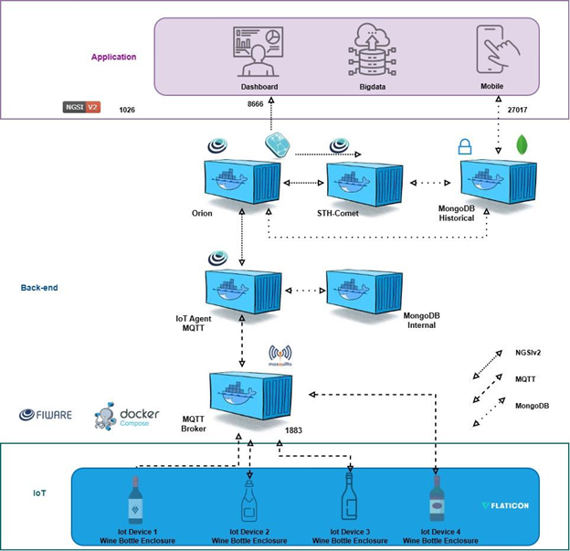

# StarLight | Monitoramento de Vinheria

**Check Point 5: Vinheria Full | Edge Computing Systems | FIAP**  
**Professor:** Prof. Dr. Fábio Henrique Cabrini  
**Documentação revisada em:** 30 de outubro de 2026

O StarLight monitora temperatura, umidade e luminosidade em ambientes de armazenamento de vinhos. A solução combina ESP32, sensores ambientais, comunicação MQTT, serviços FIWARE e um dashboard web para acompanhar medições, consultar históricos e gerenciar dispositivos.

O projeto integra a Vinheria Agnello ao contexto de Internet das Coisas. O protótipo físico utiliza DHT11; a simulação Wokwi utiliza DHT22. Ambos possuem LDR, LED RGB, buzzer, LCD I2C e leitor RFID RC522 na versão de firmware examinada.

## Problema e proposta

Condições ambientais inadequadas podem comprometer a conservação dos vinhos e dificultar a identificação de riscos ao estoque. O StarLight oferece acompanhamento contínuo das três variáveis e sinalização local de anomalias, além de consulta remota do estado de cada dispositivo.

Os limites apresentados neste projeto são parâmetros de demonstração configurados no software. Eles não representam uma recomendação universal de conservação para todos os vinhos.

## Equipe

| Integrante | RM |
|---|---|
| Beatriz Soares Salve | 568791 |
| Estela Mariano da Silva | 569513 |
| Gabriela Correa Pinon Labrada | 569849 |
| Lucca Savoia Bergamasco Diniz | 569489 |

## Links e documentação

- [Repositório de entrega](https://github.com/EstelaMariano/Vinheria-Full)
- [Simulação Wokwi](https://wokwi.com/projects/479153212294129665)
- [FIWARE Descomplicado, referência da infraestrutura](https://github.com/fabiocabrini/fiware)
- [Manual de instalação e operação](MANUAL_INSTALACAO_OPERACAO.md)

O link Wokwi foi informado pela equipe. Seu conteúdo remoto não pôde ser inspecionado nesta revisão; a descrição técnica abaixo utiliza os arquivos locais `sketch.ino`, `diagram.json` e `libraries.txt`.

## Funcionalidades da versão examinada

- Medição de temperatura, umidade e luminosidade, sem geração de amostras fictícias no dashboard.
- Cadastro, atualização e remoção de dispositivos pelo IoT Agent a partir da interface.
- Consulta do estado atual pelo Orion e dos históricos pelo STH-Comet na porta 8666.
- Gráficos com períodos predefinidos, intervalo personalizado e opção de todo o período.
- Ajuste dos limites de análise por dispositivo no dashboard.
- Modo padrão e modo especialista.
- Comando remoto de alerta e configuração do idioma e da unidade de temperatura do LCD.
- Relatório de ocorrências e exportação CSV.
- Identificação de operador e UID nas ações RFID publicadas pelo dispositivo.
- Interface com opções de português, inglês, espanhol, francês, alemão e mandarim.
- Configuração do host FIWARE pelo dashboard no desenvolvimento local.
- Geração de variantes de firmware para Wokwi e hardware físico.

**Escopo técnico:** o código local utiliza React, Vite e CSS próprio. Não foi identificado backend Python/FastAPI nem Tailwind nas dependências examinadas. O proxy de desenvolvimento é implementado na configuração do Vite; a pasta `worker/` contém a integração para a versão hospedada.

## Arquitetura em camadas



A imagem fornecida pela equipe organiza a solução em três camadas. As garrafas representam dispositivos IoT encapsulados. A multiplicidade de dispositivos indica a possibilidade de monitorar mais de uma unidade, não a comprovação de quatro protótipos físicos montados.

### IoT

O ESP32 coleta temperatura e umidade pelo DHT11 ou DHT22 e luminosidade pelo LDR. O firmware avalia suas faixas locais, controla RGB e buzzer, apresenta dados no LCD e lê credenciais RFID. O Wi-Fi permite publicar telemetria e receber comandos por MQTT.

O encapsulamento inspirado em uma garrafa de vinho integra o produto ao ambiente da vinheria. DHT e LDR precisam manter contato com as condições externas; o gabinete não deve abafar o buzzer nem impedir o acesso ao USB, ao visor e ao leitor.

### Back-end e plataforma IoT

| Componente | Responsabilidade |
|---|---|
| Mosquitto | Intermediar publicações e assinaturas MQTT |
| IoT Agent UltraLight/MQTT | Traduzir telemetria UltraLight 2.0 para atributos NGSIv2 e encaminhar comandos ao ESP32 |
| Orion Context Broker | Manter o estado atual das entidades e emitir notificações por assinatura |
| STH-Comet | Receber notificações e disponibilizar consultas históricas |
| MongoDB interno | Persistência utilizada pelos componentes internos da plataforma |
| MongoDB histórico | Persistência dos registros históricos utilizados pelo STH-Comet |
| Docker Compose | Executar e conectar os serviços em contêineres |

O MongoDB não é consultado diretamente pelo dashboard. As setas da imagem resumem as integrações; a gravação histórica depende da assinatura do Orion que aponta para o endpoint `/notify` do STH-Comet.

### Application

O dashboard React apresenta os valores atuais, os gráficos, os cadastros, os limites e os controles remotos. O navegador utiliza as rotas `/api/orion`, `/api/iot` e `/api/sth`; no desenvolvimento, o proxy do Vite encaminha essas chamadas para a infraestrutura.

Big Data e Mobile aparecem na arquitetura conceitual como possibilidades de integração. Não há comprovação de aplicação móvel nativa ou processamento Big Data implementado nesta versão.

### Fluxos principais

1. **Telemetria:** sensores, ESP32, publicação MQTT, Mosquitto, IoT Agent e atualização da entidade no Orion.
2. **Histórico:** alteração no Orion, notificação da assinatura, STH-Comet, MongoDB histórico e consulta pelo dashboard.
3. **Comando:** dashboard, atualização do atributo de comando no Orion, IoT Agent, MQTT, ESP32 e publicação do resultado.

Uma entidade como `urn:ngsi-ld:WineCellar:garrafa011` é um identificador textual utilizado pela aplicação. A presença de `ngsi-ld` no identificador não altera o fato de que esta integração usa a API NGSIv2.

## Hardware e perfis

| Componente | Físico | Wokwi |
|---|---|---|
| Controlador | ESP32 DevKit | ESP32 simulado |
| Temperatura e umidade | DHT11, GPIO 4 | DHT22, GPIO 4 |
| Luminosidade | Entrada analógica GPIO 34 | Módulo LDR AO no GPIO 34 |
| RGB vermelho, verde e azul | GPIO 25, 26 e 27 | GPIO 25, 26 e 27 |
| Buzzer passivo | GPIO 13 | GPIO 18 |
| LCD 16x2 I2C | SDA 21, SCL 22, endereço 0x27 | Mesma configuração |
| RC522 SS, RST | GPIO 5 e 33 | GPIO 5 e 17 |
| RC522 SCK, MISO, MOSI | GPIO 18, 19 e 23 | GPIO 14, 19 e 13 |
| Device ID | `garrafa011` | `wokwi001` |
| Entity ID | `urn:ngsi-ld:WineCellar:garrafa011` | `urn:ngsi-ld:WineCellar:wokwi001` |

A tabela foi obtida dos perfis do firmware local e do circuito Wokwi local. Não reutilize a pinagem dos testes antigos. O RC522 utiliza 3,3 V. Os GPIOs do ESP32 não devem receber 5 V. A montagem física requer resistores e verificação dos níveis elétricos, detalhados no manual.

A luminosidade publicada é um percentual relativo calculado a partir do ADC. Não é uma medição calibrada em lux.

## Tecnologias e dependências

| Área | Tecnologias |
|---|---|
| Firmware | C++/Arduino, ESP32, WiFi, Wire, SPI, Preferences |
| Bibliotecas externas | PubSubClient, DHT sensor library, Adafruit Unified Sensor, LiquidCrystal I2C, MFRC522 |
| Dashboard | React, React DOM, Vite, CSS |
| Integração | MQTT, UltraLight 2.0, HTTP, NGSIv2 |
| Infraestrutura | FIWARE, Mosquitto, MongoDB, Docker Compose, AWS EC2 |

As dependências JavaScript estão em `package.json` e `package-lock.json`. As bibliotecas Arduino estão em `libraries.txt`. Não há dependências Python da aplicação que justifiquem um `requirements.txt` nesta versão. O enunciado menciona esse arquivo; a entrega deve explicar essa diferença de tecnologia e confirmar com o professor se há exigência adicional de formato.

## Organização do código

| Caminho | Conteúdo |
|---|---|
| `src/App.jsx` | Interface, consultas, limites, gráficos e ocorrências |
| `src/fiware.js` | Contrato de dados e provisionamento FIWARE |
| `src/index.css` | Estilização |
| `vite.config.js` | Servidor de desenvolvimento e proxy |
| `worker/` | Integração da versão hospedada |
| `scripts/` | Configuração do host, geração de firmware e build |
| `tests/` | Testes existentes da aplicação |
| `firmware/starlight_esp32/starlight_esp32.ino` | Fonte compartilhada dos perfis |
| `firmware/wokwi/` | Sketch, circuito e bibliotecas da simulação |
| `firmware/physical/starlight_physical/` | Sketch e configuração do dispositivo físico |
| `docs/images/arquitetura-starlight.png` | Imagem da arquitetura fornecida pela equipe |

## Instalação rápida

O procedimento completo, incluindo montagem, infraestrutura e diagnóstico, está no [manual](MANUAL_INSTALACAO_OPERACAO.md).

### Infraestrutura

Na máquina que hospedará o FIWARE, com Git, Docker e Compose instalados:

```bash
git clone https://github.com/fabiocabrini/fiware.git
cd fiware
docker compose up -d
docker compose ps
```

Se a instalação disponibilizar apenas o comando legado, utilize `docker-compose` no lugar de `docker compose`. Não execute os dois comandos para criar pilhas paralelas.

### Dashboard

Clone o repositório quando os fontes estiverem publicados:

```bash
git clone https://github.com/EstelaMariano/Vinheria-Full.git
cd Vinheria-Full
npm install
npm run dev
```

Execute os comandos na pasta que contém `package.json`. Na cópia local examinada, essa pasta se chama `Site-Vinheria-revisado`. Use uma versão de Node compatível com o Vite 8, como Node 22.12 ou superior compatível.

Abra o endereço informado pelo Vite, normalmente `http://localhost:5173`. Em **Dispositivos**, informe o IPv4 público atual da EC2, clique em **Salvar e testar** e provisione os perfis desejados.

A configuração também pode ser feita pelo terminal:

```bash
npm run configure:host -- SEU_IPV4_PUBLICO
npm run firmware:generate
```

Reinicie o Vite após a configuração pelo terminal. Pelo dashboard local, a troca dos destinos do proxy é feita durante a operação de salvar.

### Dispositivo

1. Confira a pinagem do perfil.
2. Configure as credenciais Wi-Fi e o broker.
3. Instale as bibliotecas.
4. Grave o sketch físico ou atualize os três arquivos Wokwi.
5. Abra o Monitor Serial em 115200 baud.
6. Confirme Wi-Fi, MQTT, leituras e chegada dos dados ao dashboard.

Gerar o arquivo `.ino` não atualiza automaticamente o código já gravado na ESP32 nem a cópia aberta no site Wokwi.

## Configuração e identidade FIWARE

| Item | Valor padrão |
|---|---|
| FIWARE Service | `smart` |
| FIWARE ServicePath | `/` |
| API key / grupo MQTT | `TEF` |
| Tipo da entidade | `WineCellar` |
| Protocolo no IoT Agent | `PDI-IoTA-UltraLight` |
| Transporte | `MQTT` |

Principais variáveis existentes:

```dotenv
FIWARE_HOST=SEU_IPV4_PUBLICO
FIWARE_REQUEST_TIMEOUT_MS=12000
FIWARE_SERVICE=smart
FIWARE_SERVICE_PATH=/
VITE_FIWARE_SERVICE=smart
VITE_FIWARE_SERVICE_PATH=/
VITE_FIWARE_API_KEY=TEF
VITE_IOT_CBROKER_URL=http://fiware-orion:1026
VITE_STH_NOTIFY_URL=http://fiware-sth-comet:8666/notify
VITE_ENTITY_ID=urn:ngsi-ld:WineCellar:garrafa011
VITE_ENTITY_TYPE=WineCellar
```

Os dois endereços `fiware-*` acima são destinos internos usados nas integrações da plataforma. Eles precisam resolver na rede Docker. O host acessado pelo proxy local e pelo ESP32 é o endereço alcançável da infraestrutura, não um nome exclusivo dessa rede.

Não configure URLs diretas antigas como `VITE_ORION_URL` para substituir as rotas atuais do proxy. Em hospedagem, as variáveis de execução são configuradas no provedor e não são alteradas pelo `.env.local` do computador.

## Provisionamento e dados

O cadastro pelo dashboard cria ou verifica o grupo de serviço, cadastra o dispositivo no IoT Agent e configura a assinatura histórica no Orion.

| Object ID | Atributo Orion | Finalidade |
|---|---|---|
| `t`, `h`, `l` | `temperature`, `humidity`, `luminosity` | Medições |
| `am`, `ast`, `ar` | `alertMode`, `alertState`, `alertReason` | Estado e motivo dos alertas |
| `ab` | `alarmSilenced` | Reconhecimento temporário |
| `op`, `uid` | `lastOperator`, `lastOperatorUid` | Identificação do operador |
| `act`, `at` | `lastAction`, `lastActionTime` | Última ação e horário |
| `lang`, `unit` | `displayLanguage`, `temperatureUnit` | Preferências do visor |
| `mt`, `ss` | `measurementTime`, `sensorStatus` | Horário e qualidade da leitura |
| `hb`, `cs` | `heartbeat`, `connectivityStatus` | Atividade e conectividade |

Os tópicos seguem `/TEF/DEVICE_ID/attrs`, `/TEF/DEVICE_ID/cmd` e `/TEF/DEVICE_ID/cmdexe`. O firmware monta esses caminhos a partir da API key e do Device ID.

O Orion mantém o estado atual. Ele não substitui o STH-Comet como fonte dos gráficos históricos. A assinatura criada pelo dashboard utiliza `attrsFormat: legacy` e metadados incluindo `TimeInstant`.

## Limites, alertas e RFID

| Grandeza | Mínimo | Máximo |
|---|---:|---:|
| Temperatura | 10 °C | 16 °C |
| Umidade | 60% | 80% |
| Luminosidade relativa | 0% | 70% |

A comparação considera anormal o valor abaixo do mínimo ou acima do máximo. Os limites do dashboard são persistidos no `localStorage` por dispositivo. O firmware possui constantes próprias com esses valores e não recebe atualizações de limites pela implementação examinada.

| Situação | RGB | Buzzer |
|---|---|---|
| Normal | Verde | Sem alarme |
| Temperatura fora da faixa local | Vermelho | 900 Hz, dois bipes por ciclo |
| Umidade fora da faixa local | Azul | 1350 Hz, um bipe longo por ciclo |
| Luminosidade fora da faixa local | Amarelo | 1900 Hz, três bipes por ciclo |
| Alerta manual remoto | Magenta | 700 Hz |
| Alerta reconhecido por RFID | Apagado durante a pausa | Pausado |

O ciclo sonoro tem 1400 ms. Anomalias simultâneas alternam a saída a cada 1800 ms. As cores identificam o tipo de condição; não constituem uma escala universal de gravidade verde, amarelo e vermelho.

A tag autorizada registra operador e UID e pausa luz e som por 60 segundos. Se a condição persistir, o alarme retorna. Uma nova condição não reconhecida também pode interromper a pausa. O reconhecimento não modifica a leitura nem resolve fisicamente a causa. Tag desconhecida é registrada e recebe feedback de rejeição.

O comando remoto `setAlertMode` aceita `on` e `off`. Se existir anomalia local, `off` reconhece temporariamente o alarme em vez de eliminar a condição.

## Consulta e atualização

- Sensores: intervalo de 2500 ms.
- Publicação periódica: 3000 ms, além de eventos que forçam publicação.
- Estado atual no dashboard: consulta a cada 2000 ms.
- Histórico: consulta a cada 5000 ms.
- O heartbeat ajuda a distinguir atividade nova de dados antigos.

Os períodos predefinidos consultam um número limitado de amostras. A opção de todo o período solicita até 1000 amostras por grandeza no código examinado. Não deve ser interpretada como exportação garantida de todo o banco sem paginação.

## Rastreabilidade do CP5

| Requisito | Implementação identificada | Evidência ou condição de validação |
|---|---|---|
| DHT11 físico | Perfil físico, GPIO 4 | Sketch e teste na bancada |
| DHT22 simulado | Perfil Wokwi e circuito local | Simulação fornecida |
| LDR | ADC no GPIO 34 | Leituras físicas e simuladas |
| Cadastro e gerenciamento IoT | Interface e funções em `src/fiware.js` | IoT Agent e entidade Orion |
| Gráficos históricos :8666 | Consultas STH-Comet | Resposta HTTP e gráficos com amostras |
| Ajuste de triggers | Campos por dispositivo | Persistência local; sem sincronização dos limites com a ESP32 |
| Sons diferentes por anomalia | Firmware com padrões distintos | Teste de cada grandeza |
| Alerta remoto | Comando manual `setAlertMode` | Confirmação pelo firmware |
| LED azul piscante automático pelo front-end | Não identificado no código examinado | Requer implementação e validação |
| RFID | Autorização, operador, UID e pausa | Teste com tag conhecida e desconhecida |
| Encapsulamento | Conceito de garrafa fornecido pela equipe | Fotografias e inspeção do protótipo |
| Documentação | README e manual | Arquivos deste pacote |
| Dependências | `package*.json` e `libraries.txt` | Justificar ausência de Python |
| Hands-on e vídeo | Entrega demonstrativa | Vídeo não fornecido nesta revisão |

### Diferenças que precisam ser resolvidas para conformidade integral

O enunciado exige ativação automática pelo front-end e LED azul piscando até a normalização. Nesta versão, as anomalias são avaliadas localmente pelo firmware, o comando remoto é manual e o RGB mantém a cor da condição selecionada. Não foi identificada uma saída independente para o LED azul obrigatório.

Também não foi identificado envio dos novos triggers do navegador ao firmware. Assim, alterar o limite visual pode mudar o alerta do dashboard sem alterar o comportamento físico. O RFID pode apagar a sinalização durante a pausa, comportamento que precisa ser conciliado com a exigência de indicação visual persistente.

Essas observações descrevem o código examinado e não afirmam que testes físicos ou serviços remotos foram aprovados nesta revisão.

## Evidências para apresentação

Registrar o protótipo montado e encapsulado, as três medições no dashboard, os gráficos com dados STH, o cadastro IoT, os triggers, cada padrão sonoro, o comando remoto e o operador RFID. O vídeo deve mostrar a sequência completa e a normalização das condições.

**Vídeo demonstrativo:** link ainda não fornecido pela equipe.

## Verificação do software

Na pasta do dashboard:

```bash
npm run lint
npm test
npm run build:site
npm run validate:site
```

Os comandos existem em `package.json`. Esta revisão produziu documentação e não executou novamente esses testes nem validou o circuito físico.

## Segurança e limitações

A configuração de referência é uma prova de conceito. Restrinja portas às origens necessárias, mantenha MongoDB fora da exposição pública e não publique credenciais Wi-Fi ou chaves SSH. A API key `TEF` organiza a integração e não equivale a autenticação robusta de produção.

Preferências e ocorrências mantidas no navegador não constituem uma trilha de auditoria central imutável. A identificação por UID RFID também não deve ser tratada como autenticação segura contra clonagem.

## Referências

- Material da disciplina e enunciado CP5 fornecidos pela equipe.
- [FIWARE Descomplicado](https://github.com/fabiocabrini/fiware).
- Código local do dashboard, firmware e circuito Wokwi examinados em 30/10/2026.
- Imagem de arquitetura e informações de integrantes fornecidas pela equipe.

Não foi estabelecida uma licença própria para o StarLight no material analisado. Consulte as licenças das dependências e da infraestrutura antes de redistribuí-las.

